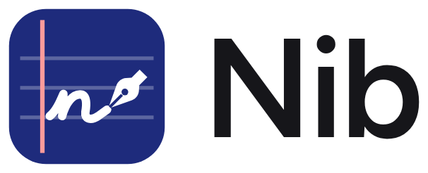
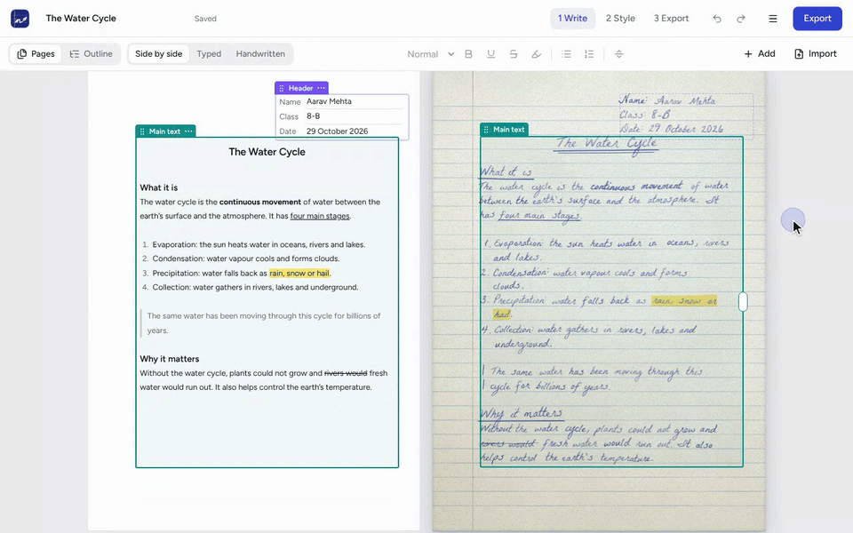
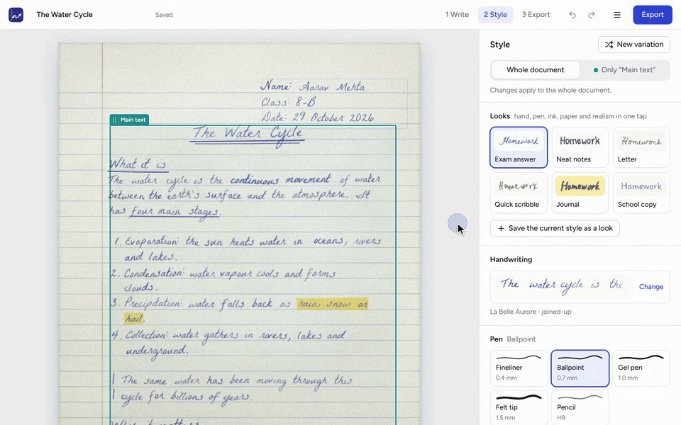
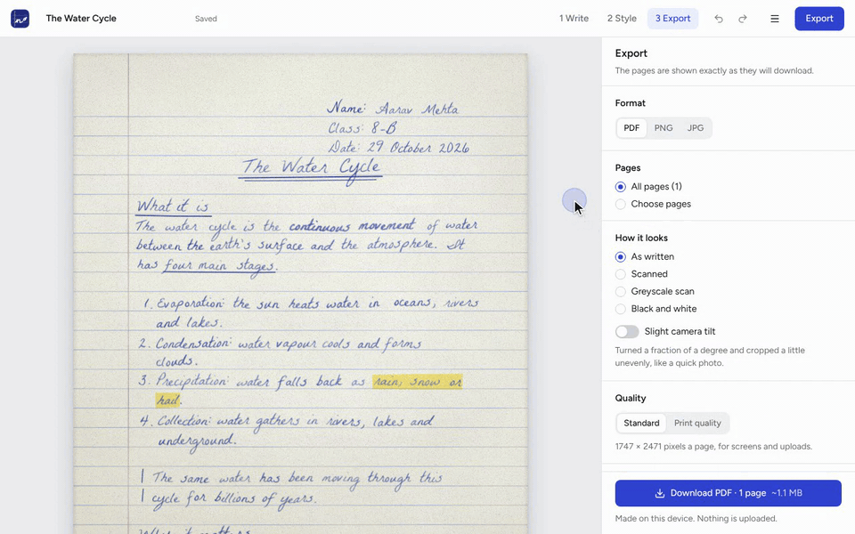
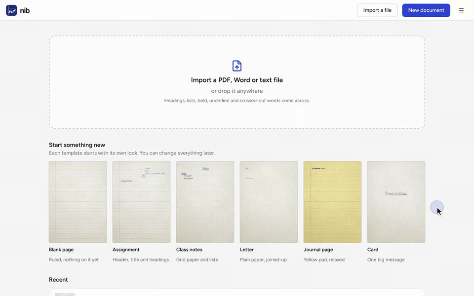
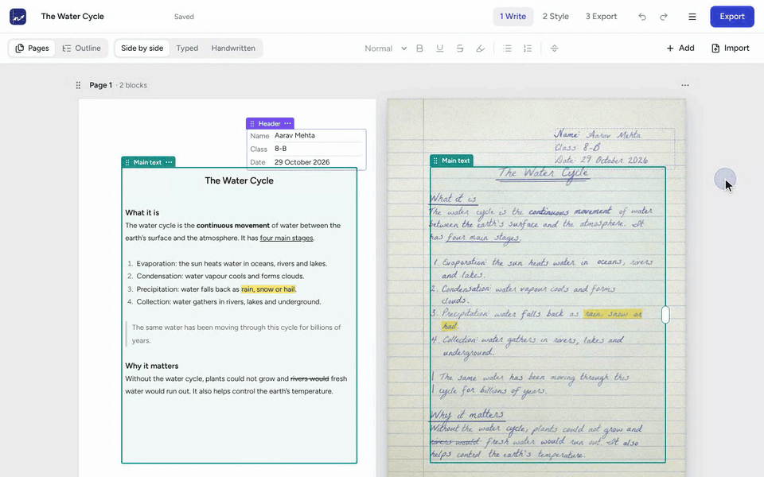
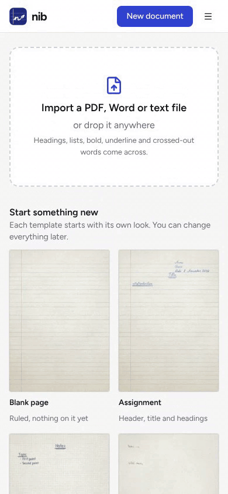
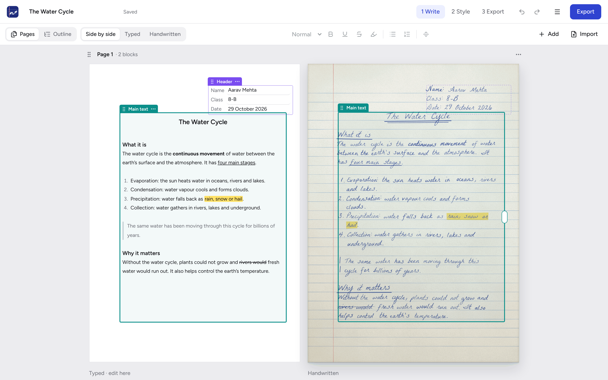

<p align="center">
  <a href="https://nvmaditya.github.io/nib-engine/">
    <picture>
      <source media="(prefers-color-scheme: dark)" srcset="docs/assets/logo-dark.png">
      
    </picture>
  </a>
</p>

<p align="center">
  <strong>Turn typed text into realistic handwritten pages.</strong><br>
  Write, style and export pages that look written by hand, entirely in your browser.
</p>

<p align="center">
  <a href="https://nvmaditya.github.io/nib-engine/"><strong>Open Nib</strong></a>
  &nbsp;·&nbsp;
  <a href="docs/USER_GUIDE.md">User guide</a>
  &nbsp;·&nbsp;
  <a href="docs/DEVELOPMENT.md">Development</a>
</p>

<p align="center">
  <a href="https://github.com/nvmaditya/nib-engine/actions/workflows/deploy.yml"></a>
  
  
  
  
</p>

<p align="center">
  
</p>

## About

Nib is a web app that turns typed text into pages that look handwritten: assignments, notes, letters, journal pages and cards. You type in a rich-text editor, choose a hand, a pen, an ink and a paper, and download the pages as a PDF or images.

The handwriting comes from Nib's own drawing engine, not from a font rendered as-is. Every letter is reshaped from the font's outlines and drawn with a simulated pen, so no two letters are the same, lines drift the way real writing does, and ink pools and thins with pressure.

Everything runs in the browser. Documents, fonts and settings stay on your device, and nothing is uploaded.

## Highlights

- **Realistic handwriting.** Each letter bends a little differently, baselines climb and sag, downstrokes press harder, and the ink runs darker and lighter. Optional mistakes are crossed out and written again.
- **33 hands and five pens.** Joined-up, print, neat and messy hands, or upload your own TTF, OTF or WOFF. Fineliner, ballpoint, gel, felt tip and pencil, each drawn at its real line width.
- **Real paper.** Ruled, spiral, yellow pad, grid, plain or a photographed sheet, with room lighting, show-through, punch holes and a fold crease.
- **Blocks you can place anywhere.** Text, Header and Margin note blocks sit wherever you put them. A long block flows onto the next pages, and each page's part can be moved, split off or joined back.
- **Import.** Bring in a PDF, Word or text file and Nib lays it out as handwriting. You can check and edit the text before anything is written.
- **Clean exports.** PDF, PNG or JPG, at screen or print quality, as written, scanned, greyscale or black and white, with an optional camera tilt. Files carry no metadata: no author, no producer, no dates.
- **Installable and offline.** Install Nib as an app. After its first load it works with no connection, every hand and both file readers included.
- **Built for keyboards and phones.** A Ctrl+K command palette, a shortcut sheet, full undo, light and dark themes, and phone layouts with bottom sheets.

## See it in action

<table>
  <tr>
    <td width="50%" valign="top">
      
      <p align="center"><b>Style</b>: change the hand, pen, ink and paper, and the pages redraw.</p>
    </td>
    <td width="50%" valign="top">
      
      <p align="center"><b>Export</b>: preview scan looks and tilt exactly as they download.</p>
    </td>
  </tr>
  <tr>
    <td width="50%" valign="top">
      
      <p align="center"><b>Import</b>: bring in a PDF, Word or text file and check it before it is written.</p>
    </td>
    <td width="50%" valign="top">
      
      <p align="center"><b>Keyboard</b>: the Ctrl+K palette, dark theme and the shortcut sheet.</p>
    </td>
  </tr>
</table>

<p align="center">
  <br>
  <b>Phones</b>: one page at a time, with panels as bottom sheets.
</p>

## How it works

A document goes through three stages.

1. **Write.** Type in a rich-text editor beside a live handwritten copy of each page. Text styles (title, heading, note), bold, underline, highlight, crossed-out words, lists and page breaks all carry through to the handwriting. Click a word on a handwritten page to put the caret there.
2. **Style.** Pick one of six looks (Exam answer, Neat notes, Letter, Quick scribble, Journal, School copy) or set the hand, pen, ink, paper and how natural the writing is yourself. Styles apply to the whole document or to a single block. If a change makes the document run longer, **Fit back** shrinks it to the page count it had.
3. **Export.** Choose the format, the pages and the look, and download. The preview is drawn by the same engine at the same size, so what you see is what you get.

<p align="center">
  
</p>

Home keeps your documents with a drawn thumbnail of each, plus six templates to start from (Blank page, Assignment, Class notes, Letter, Journal page and Card). The [user guide](docs/USER_GUIDE.md) covers every feature in detail.

## Privacy

- Documents, uploaded fonts, saved looks and settings are stored in your browser (IndexedDB) and never leave the device.
- Files you import are read in the browser.
- Exports are written by Nib itself. PDFs have no Info dictionary or XMP stream; PNGs and JPGs keep only their picture data; ZIPs use a fixed date.

## Getting started

Use it online at **[nvmaditya.github.io/nib-engine](https://nvmaditya.github.io/nib-engine/)**. To install it, use your browser's **Install** button (Chrome, Edge) or **Add to Home Screen** (Safari on iPhone and iPad).

To run it locally you need Node.js 22 (the version CI uses):

```bash
git clone https://github.com/nvmaditya/nib-engine.git
cd nib-engine
npm ci
npm run dev
```

Then open the address Vite prints, usually http://localhost:5173.

## Development

| Command | What it does |
|---|---|
| `npm run dev` | Start the development server |
| `npm test` | Run the unit and component tests (Vitest, jsdom) |
| `npm run typecheck` | Type-check the app, the tests and the build config |
| `npm run build` | Type-check, then build the site into `dist/` |
| `npm run test:browser` | Run the tests that draw real pixels in Chromium |
| `npm run smoke` | Run the browser tests, then build, serve at `/nib-engine/` and drive the whole app in Chromium, including an offline reload and a two-tab update |

`npm run test:browser` and `npm run smoke` need Chromium and Playwright on the machine. Every push to `main` is tested, built and deployed to GitHub Pages by [`.github/workflows/deploy.yml`](.github/workflows/deploy.yml).

See [docs/DEVELOPMENT.md](docs/DEVELOPMENT.md) for the full project structure, the Lighthouse PWA audit and deployment notes.

## Tech stack

| Area | Tools |
|---|---|
| App | React 19, TypeScript (strict), Vite 8 |
| Interface | Tailwind CSS 4, Radix primitives in the style of shadcn/ui, cmdk, vaul, lucide icons |
| Editor | TipTap 3 (ProseMirror), converting both ways to Nib's markup |
| State and storage | Zustand, IndexedDB through idb |
| Handwriting engine | Plain JavaScript in `src/engine/`, using opentype.js for glyph outlines |
| Import | PDF.js and mammoth, loaded only when needed |
| Offline | vite-plugin-pwa with Workbox |
| Testing | Vitest and Testing Library, plus Playwright for browser tests and the smoke run |

## Project structure

```
src/
  engine/      the handwriting engine: glyphs, layout, ink, paper, scan looks (plain JS + .d.ts)
  store/       open document, saved documents, undo history, IndexedDB
  app/         root component, routes, service worker and update flow
  shell/       top bar, stage navigation, menu, command palette, shortcuts
  features/
    home/      Home, templates, recent documents and thumbnails
    import/    the Import dialog and its preview
    write/     Pages and Outline views
    style/     the Style panel, looks, hands and uploaded fonts
    export/    the Export panel, renderer, and PDF/ZIP writers
    editor/    the rich-text block editor
    pages/     handwritten page views, block frames and dragging
    doc/       document actions, phone sheets and first-visit tips
  components/  shared UI components
public/        fonts (with licences), paper photo, icons
scripts/       smoke test, test fixtures, icon generator
```

## Acknowledgements

- The handwriting fonts are open-licensed fonts from Google Fonts, served via [Fontsource](https://fontsource.org). [FONTS.md](FONTS.md) lists each font with its licence and copyright.
- Nib is built on [opentype.js](https://github.com/opentypejs/opentype.js), [PDF.js](https://github.com/mozilla/pdf.js), [mammoth](https://github.com/mwilliamson/mammoth.js), [React](https://react.dev), [TipTap](https://tiptap.dev), [Tailwind CSS](https://tailwindcss.com), [Radix](https://www.radix-ui.com), [shadcn/ui](https://ui.shadcn.com), [cmdk](https://cmdk.paco.me), [vaul](https://vaul.emilkowal.ski), [Zustand](https://github.com/pmndrs/zustand), [idb](https://github.com/jakearchibald/idb) and [vite-plugin-pwa](https://vite-pwa-org.netlify.app).

---

<sub>Nib was previously called Longhand. Work saved at the old address is kept by the browser and opens at the new one.</sub>
